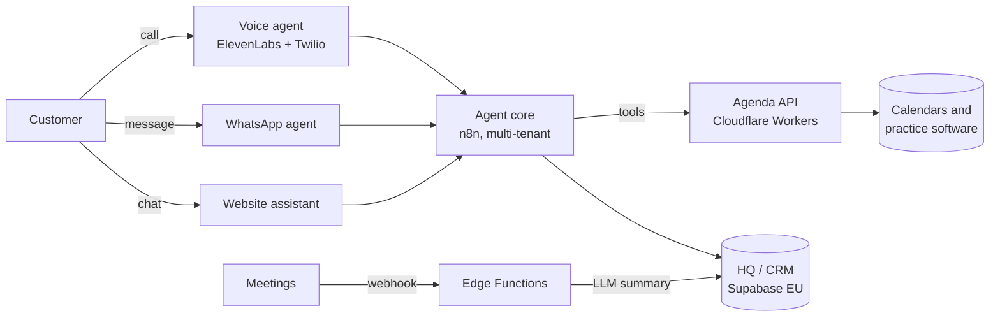

# João Pedro Franco

**AI Product Engineer · Co-founder of [ELEVA](https://www.eleva-ai.pt)** · Portugal 🇵🇹

I build LLM-powered products that run real businesses: voice and WhatsApp agents that answer customers, book appointments and qualify leads, plus the scheduling, CRM and automation infrastructure behind them. I work across the whole loop: discovery with the business owner, agent and prompt design, system architecture, evaluation, shipping and iterating in production.

---

## What we're building at ELEVA

ELEVA helps Portuguese businesses (clinics, salons, trainers, HVAC, retail) replace manual work with AI agents and automation. Everything below is in production or active development. The code lives in the private `eleva-pt` organisation, and I'm happy to walk through any of it in an interview.

### 🗣️ ELEVA Atende: multi-channel AI agents
Customer-facing agents on **voice (ElevenLabs + Twilio), WhatsApp, website chat and email**, built on one multi-tenant core.
- One agent platform, many businesses: each tenant is configuration (`business_config`, `voice_config`, `chat_config`), not a fork.
- Voice intake: post-call webhooks turn a phone conversation into a structured lead or booking in the CRM.
- Tool use: agents call the scheduling API to check real availability and create bookings, and hand off to a human when needed.
- Prompts and agent configs are versioned in Git and reviewed through pull requests. Changes go to a test environment before they touch a live client.

### 📅 Agenda: scheduling engine that AI agents can call
A booking engine that computes **real availability across every calendar and practice-management system** a business uses (Google Calendar, Microsoft 365, clinic software), and exposes it through a public page, an embeddable widget, a REST API and agent tools.
- Built on **Cloudflare Workers** with **one database per client** (tenant isolation by design) and encrypted secrets.
- Connector architecture: a connector is written once and serves every client on that tool.
- Layered product model (core → modules → sector template → client config), applied with a single command.
- Pre-production pipeline: everything is tested in `preprod` before production. In production since Nov 2026, starting with ELEVA's own website.

### 🧠 HQ: internal CRM with LLM pipelines
Our operating system: lead CRM, client app and team dashboard on **Supabase (EU region)** with Deno Edge Functions.
- **Meeting intelligence:** Fathom webhook → signature verification → company matching by participant e-mail → **Claude** writes a structured summary → stored in the CRM and in Drive.
- **Daily review agent:** reads the latest commits, Markdown diffs and changed Google Docs for every active account, and uses **Claude** to propose CRM updates, flag stalled leads and find repositories without an account record. Human-in-the-loop by design: nothing changes until a person approves it, and failures (for example, an exhausted API balance) open a task automatically.
- Sales funnel automation: lead intake from Meta ads and forms, follow-up sequences, deadline tracking and team alerts.

### 🔐 Secure CMS auth for client sites
A Cloudflare Worker that lets clients edit their sites without GitHub accounts: e-mail OTP via Cloudflare Access, our own signed sessions, and short-lived **GitHub App tokens scoped to a single repository**. Tokens never reach the browser.

---

## How it fits together

---

## How I work

- **Start from the customer's pain.** Every project begins with an analysis of how the business works today (`ANALISE.md`) and a decision log with the assumption behind each choice (`DECISOES.md`).
- **Workflow before autonomy.** Deterministic workflows where the path is known; agents with tools where judgement is needed.
- **Privacy is part of the design.** Clients include clinics, so health data is handled under GDPR: EU hosting, data minimisation, no real personal data in prompts or examples, secrets only in a vault and environment variables.
- **AI-native engineering.** Claude Code, MCP servers and custom skills are part of the daily workflow. Everything goes through pull requests and is reviewed by the other founder.

## Stack

**LLMs & agents** · Claude (Sonnet, Haiku) · OpenAI · ElevenLabs Conversational AI · Twilio · MCP · Claude Code
**Backend** · TypeScript · Cloudflare Workers & Pages · Supabase (Postgres, Edge Functions) · n8n
**Product** · React · Astro · Product design & UX · Rapid prototyping

---

📫 [eleva-ai.pt](https://www.eleva-ai.pt) · open to **AI Engineer** roles
